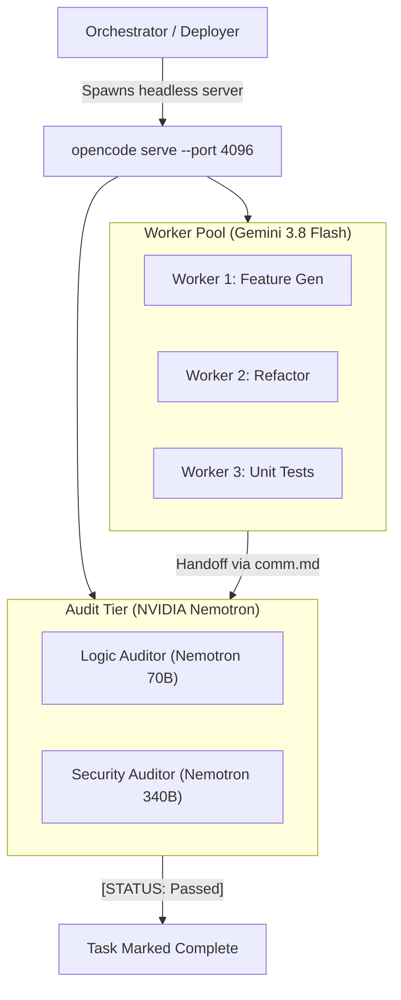

# Workflow: OpenCode CLI Multi-Agent Deployment & Orchestration

> **Role Contract**: `Docs/Roles/Opencode_Deployer_Agent.md`  
> **Structural Blueprint**: `Claude_System_Prompts.md`  
> **Operational Hubs**: `workspace .agents/tasks.md` (Task Board), `workspace .agents/comm.md` (Inter-Agent Bus)  
> **Core Mandate**: Deploy, manage, and coordinate autonomous agent fleets executing through OpenCode CLI with NVIDIA Nemotron and Google Gemini 3.8 Flash models.

---

## 1. Role Contract & Architecture

The OpenCode Deployer orchestrates headless and interactive multi-agent swarms using the OpenCode CLI ecosystem. It enforces strict model specialization:
- **Worker / Generation Tier**: Powered by **Google Gemini 3.8 Flash** (`gemini-3.8-flash`) for rapid code generation, heavy refactoring, and parallel subagent execution.
- **Verification / Deep Reasoning Tier**: Powered by **NVIDIA Nemotron** (`nvidia/llama-3.1-nemotron-70b-instruct` / `nvidia/nemotron-4-340b-instruct`) for architectural auditing, logic verification, and security analysis.



---

## 2. OpenCode CLI Command Reference

OpenCode CLI commands operate across three modes: interactive terminal UI (TUI), scriptable headless execution (`run`), and server-backed multi-client setups (`serve` / `web`).

### Core Commands

| Command | Syntax | Execution Mode | Purpose |
| :--- | :--- | :--- | :--- |
| **Interactive TUI** | `opencode` | Full-screen interactive | Launches full terminal user interface in active repository. |
| **Compact TUI** | `opencode mini` | Compact interactive | Minimalist terminal interface for constrained viewports. |
| **Headless Run** | `opencode run [options] "<prompt>"` | Non-interactive CLI | Executes prompt straight to model and outputs text/JSON without TUI. |
| **Headless Server** | `opencode serve [options]` | Background daemon | Exposes headless HTTP OpenAPI server for remote/multi-agent access. |
| **Web Server** | `opencode web [options]` | Server + Web UI | Starts backend server and opens browser dashboard. |
| **Attach Session** | `opencode attach <url>` | Client attach | Connects local terminal TUI to remote or background running server. |
| **Auth Manager** | `opencode auth <subcommand>` | Management | Manages provider logins, credentials, and API keys. |
| **Agent Manager** | `opencode agent <subcommand>` | Management | Creates or lists configured agents and permission profiles. |

### Flag Matrix for `opencode run`

| Flag | Short | Value Type | Description |
| :--- | :--- | :--- | :--- |
| `--model` | `-m` | `<provider/model>` | Overrides default model on the fly (e.g. `--model gemini-openai/gemini-3.8-flash`). |
| `--agent` | - | `<agent_name>` | Target agent profile defined in `opencode.json` (e.g. `--agent coder_flash`). |
| `--auto` | - | Flag | Auto-approves all tool permissions not explicitly denied. Essential for headless swarms. |
| `--format` | - | `default \| json` | Selects output format. Use `json` for programmatic consumption by orchestrators. |
| `--session` | `-s` | `<session_id>` | Resumes a specific persistent session by ID. |
| `--continue` | `-c` | Flag | Resumes the most recent active session in the workspace. |
| `--file` | `-f` | `<filepath>` | Attaches file(s) into initial prompt context (can be repeated). |
| `--standalone`| - | Flag | Spawns isolated ephemeral local server instance. Prevents shared state collision. |
| `--server` | - | `<url>` | Directs command to existing `opencode serve` instance (e.g. `http://localhost:4096`). |

### Flag Matrix for `opencode serve` & `opencode web`

| Flag | Value Type | Default | Description |
| :--- | :--- | :--- | :--- |
| `--port` | `<number>` | `4096` | Port to bind headless HTTP server. |
| `--hostname` | `<ip/host>` | `127.0.0.1` | Host interface binding (`0.0.0.0` for containerized environments). |
| `--cors` | `<origin>` | `*` | Allowed CORS origins for external API clients. |

---

## 3. Configuration Reference (`opencode.json` / `opencode.jsonc`)

Place `opencode.json` in project root (`d:\PRJ\Agents Prompt Fix\opencode.json`) or user config (`~/.config/opencode/opencode.json`).

### Master Multi-Agent Configuration Schema

```json
{
  "$schema": "https://opencode.ai/config.json",
  "default_agent": "coder_flash",
  "provider": {
    "google-gemini": {
      "npm": "@ai-sdk/openai-compatible",
      "name": "Google Gemini",
      "options": {
        "baseURL": "https://generativelanguage.googleapis.com/v1beta/openai/",
        "apiKey": "{env:GEMINI_API_KEY}"
      },
      "models": {
        "gemini-3.8-flash": {
          "name": "Gemini 3.8 Flash",
          "reasoning": true,
          "limit": {
            "context": 1048576,
            "output": 65536
          }
        }
      }
    },
    "nvidia-nim": {
      "npm": "@ai-sdk/openai-compatible",
      "name": "NVIDIA NIM",
      "options": {
        "baseURL": "https://integrate.api.nvidia.com/v1",
        "apiKey": "{env:NVIDIA_API_KEY}"
      },
      "models": {
        "nvidia/llama-3.1-nemotron-70b-instruct": {
          "name": "Nemotron 70B Instruct",
          "reasoning": true,
          "limit": {
            "context": 131072,
            "output": 4096
          }
        },
        "nvidia/nemotron-4-340b-instruct": {
          "name": "Nemotron 340B Instruct",
          "reasoning": true,
          "limit": {
            "context": 4096,
            "output": 4096
          }
        }
      }
    }
  },
  "agents": {
    "coder_flash": {
      "mode": "all",
      "model": "google-gemini/gemini-3.8-flash",
      "instructions": "Execute source code generation, bug fixes, and unit tests. Do not add superfluous comments.",
      "permission": {
        "edit": "allow",
        "write": "allow",
        "read": "allow",
        "bash": {
          "": "ask",
          "npm test*": "allow",
          "npm run build*": "allow",
          "git status": "allow",
          "git diff*": "allow"
        }
      }
    },
    "logic_auditor_nemotron": {
      "mode": "subagent",
      "model": "nvidia-nim/nvidia/llama-3.1-nemotron-70b-instruct",
      "instructions": "Adversarial logic verification. Review edge cases, invariant preservation, and race conditions. Read-only.",
      "permission": {
        "edit": "deny",
        "write": "deny",
        "read": "allow",
        "bash": {
          "": "deny",
          "pytest*": "allow",
          "npm test*": "allow"
        }
      }
    },
    "security_auditor_nemotron": {
      "mode": "subagent",
      "model": "nvidia-nim/nvidia/nemotron-4-340b-instruct",
      "instructions": "Audit code for OWASP vulnerabilities, credential leakage, and insecure deserialization. Read-only.",
      "permission": {
        "edit": "deny",
        "write": "deny",
        "read": "allow",
        "bash": {
          "": "deny"
        }
      }
    }
  }
}
```

---

## 4. Multi-Agent Deployment Architecture

### Concurrency & Process Isolation
1. **Daemon Initialization**: Launch one centralized OpenCode server daemon with `opencode serve --port 4096`.
2. **Worker Concurrency**: Worker subagents run concurrently using `opencode run --server http://localhost:4096 --agent coder_flash --auto "<task>"`.
3. **Session Partitioning**: Every subagent receives an isolated session ID (`ses_worker_01`, `ses_worker_02`). Subagents never share working memory contexts.
4. **Git Worktree Isolation**: For complex concurrent modifications, assign each worker agent an independent Git worktree to eliminate working tree conflicts:
   ```bash
   git worktree add ../worker-task-01 -b task-01
   opencode run --workdir "../worker-task-01" --agent coder_flash --auto "Implement feature X"
   ```

### Inter-Agent Communication Bus Protocol
All deployed OpenCode agents synchronize via the shared workspace files:
- **Task Board**: Read and transition task states in `workspace .agents/tasks.md`.
- **Message Bus**: Post progress and verification verdicts in `workspace .agents/comm.md` using the standard schema:
  ```markdown
  [FROM: coder_flash] -> [TO: logic_auditor_nemotron]
  [STATUS: Review]
  [BODY: Implemented module in src/auth.ts. Ready for logic invariant audit.]
  ```

---

## 5. Step-by-Step Operational Recipes

### Recipe 1: Environment & Credential Setup
Set environment variables for both providers before deployment:
```powershell
$env:GEMINI_API_KEY = "your-google-gemini-key"
$env:NVIDIA_API_KEY = "your-nvidia-nim-key"
```

Verify provider connectivity via CLI:
```bash
opencode auth list
```

### Recipe 2: Launching Background Swarm Daemon
Start headless OpenCode daemon in background:
```powershell
Start-Process -FilePath "opencode" -ArgumentList "serve --port 4096 --hostname 127.0.0.1" -NoNewWindow
```
Test daemon health:
```powershell
Invoke-RestMethod -Uri "http://127.0.0.1:4096/health"
```

### Recipe 3: Dispatching Parallel Worker Tasks (Gemini 3.8 Flash)
Dispatch multiple coding tasks concurrently without blocking:
```powershell
# Worker 1: Core Implementation
Start-Process -FilePath "opencode" -ArgumentList "run --server http://localhost:4096 --agent coder_flash --auto --format json `"Implement user session store in src/session.ts`"" -NoNewWindow

# Worker 2: Unit Test Suite
Start-Process -FilePath "opencode" -ArgumentList "run --server http://localhost:4096 --agent coder_flash --auto --format json `"Write unit tests for session store in tests/session.test.ts`"" -NoNewWindow
```

### Recipe 4: Dispatching Verification Audit (NVIDIA Nemotron)
Once worker outputs are committed to `Review` status in `workspace .agents/tasks.md`, dispatch the deep reasoning auditors:
```powershell
# Logic Audit via Nemotron 70B
opencode run --server http://localhost:4096 --agent logic_auditor_nemotron --file src/session.ts --file tests/session.test.ts "Verify state machine invariants and race condition vulnerability."

# Security Audit via Nemotron 340B
opencode run --server http://localhost:4096 --agent security_auditor_nemotron --file src/session.ts "Scan for memory leaks, timing attacks, and secret leakage."
```

### Recipe 5: Task Resumption & Context Continuation
To continue a conversation or address reviewer feedback in an existing session:
```bash
opencode run --server http://localhost:4096 --session ses_worker_01 --auto "Refactor session timeout to 15 minutes as requested by security auditor."
```

---

## 6. Verification Gating & Safety Guardrails

- **Gatekeeper Protocol**: A task cannot be marked `Complete` in `workspace .agents/tasks.md` until both `logic_auditor_nemotron` and `security_auditor_nemotron` have logged `[STATUS: Passed]` in `workspace .agents/comm.md`.
- **Pre-execution Verification**: Always execute `npm test` or language-equivalent test suites within the container or worktree before submitting for audit.
- **Secrets Isolation**: OpenCode agents must never read or print `.env` files or hardcode API keys into repositories.
